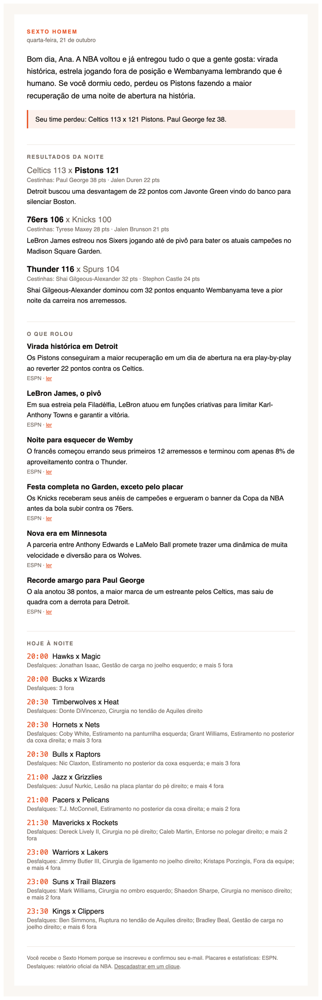
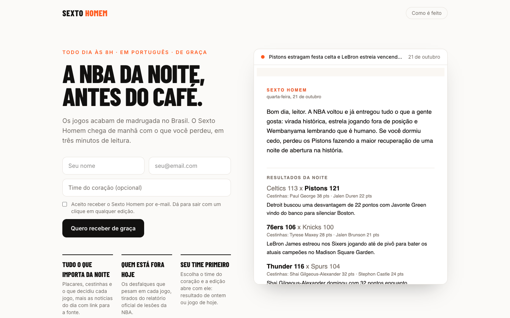
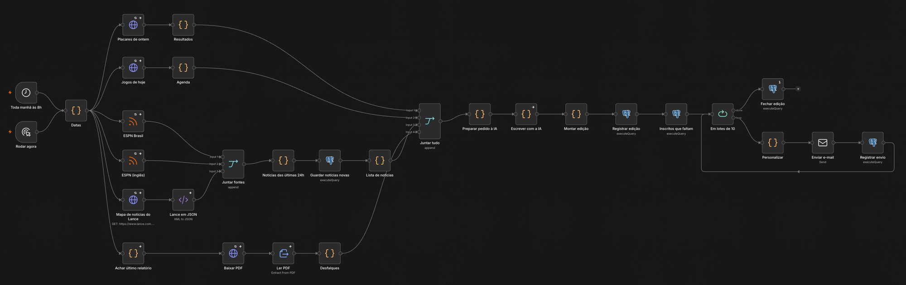

# Sexto Homem

[](https://github.com/guialmm/sexto-homem/actions/workflows/ci.yml)

**A NBA da noite, antes do café.** Newsletter diária em português: os jogos acabam de
madrugada no Brasil, e às 8h chega o que você perdeu — resultados, as notícias que
importam e quem está fora dos jogos de hoje. Tudo coletado, escrito e enviado por um
workflow no **n8n**, sem ninguém encostar em nada.

| A edição | O site de inscrição |
|---|---|
|  |  |

## O workflow



Todo dia às 8h (horário de Brasília):

1. **Coleta** em paralelo:
   - placares de ontem e jogos de hoje — JSON da ESPN;
   - notícias — RSS da ESPN Brasil e da ESPN, e o *sitemap* de notícias do Lance (XML);
   - desfalques — o **relatório oficial de lesões da NBA, em PDF**.
2. **Descarta notícia repetida**: a URL é única no banco, então nada que saiu ontem volta hoje.
3. **A IA (Gemini) escreve a edição**: assunto, abertura, um comentário por jogo, as 6
   notícias mais relevantes traduzidas e resumidas, os motivos das lesões em português e
   os dois desfalques que mais pesam em cada jogo.
4. **Monta o e-mail** e **personaliza por leitor**: primeiro nome, link de descadastro e,
   se ele escolheu um time, uma linha no topo — "Seu time perdeu: Celtics 113 x 121 Pistons".
5. **Envia em lotes de 10** e registra cada envio.
6. Se qualquer passo falhar, o workflow de **alertas** manda um e-mail com o erro e o link da execução.

A inscrição é outro workflow, com três *webhooks*: inscrever, confirmar (**double opt-in**)
e descadastrar.

## Problemas reais do caminho

O guia deste projeto diz: *nem toda fonte entrega os dados prontos*. Foi exatamente isso.

- **O relatório de lesões é um PDF sem estrutura.** O texto sai uma palavra por linha
  ("Dennis, / RayJ / Questionable / G / League / - / Two- / Way"). A leitura usa padrões —
  o confronto `ATL@ORL`, o nome do time, o jogador como "Sobrenome, Nome" seguido do status —
  e foi testada contra um relatório real. Ela descarta contratos *two-way* mandados à G League
  (não são notícia) e corta o cabeçalho que o PDF repete quando uma lista atravessa a página.
- **A NBA bloqueia robôs na página que lista os relatórios** (403). Em vez de disfarçar o
  robô de navegador, o workflow usa o fato de que o PDF sai a cada 15 minutos com o horário no
  nome (`Injury-Report_2026-10-21_09_45AM.pdf`): calcula os nomes do mais recente para trás e
  baixa direto do servidor de arquivos, que é público. O robô continua se identificando.
- **RSS que pararam no tempo.** Os feeds do The Playoffs e do Jumper Brasil respondem
  normalmente, mas o último item era de junho e de setembro. Saíram; entrou a ESPN Brasil — cujo
  feed "NBA" mistura futebol, então só valem os links com `/nba/` (o mesmo filtro do sitemap do Lance).
- **Gemini sobrecarregado.** No plano gratuito, os modelos mais novos respondem *503* em
  horário de pico. A chamada percorre uma lista de modelos; quando um esgota a cota *do dia*,
  pula direto para o próximo. Na primeira edição real, dois modelos falharam e o terceiro escreveu.
- **Se a IA cair de vez, a edição sai mesmo assim**, sem os comentários — os títulos em
  português entram como foram publicados. Uma fonte fora do ar vira uma nota no rodapé
  ("Hoje faltou: relatório de lesões"), não uma edição perdida.
- **O n8n come `{{ }}`.** O nó do Postgres trata chaves duplas na SQL como expressão dele e as
  apaga. A consulta que monta a prévia do site constrói as chaves com `chr(123)`.

## Garantias

| | Como |
|---|---|
| Ninguém recebe a mesma edição duas vezes | tabela `envios` (edição, inscrito); uma nova execução depois de uma queda continua de onde parou |
| Nenhuma notícia se repete entre edições | `url` única em `noticias`; notícia coletada mas ainda não enviada continua disponível |
| A IA não inventa link nem jogador | ela só referencia jogos e notícias pelo `id` recebido; links vêm do banco; ids e nomes fora da lista são descartados |
| Descadastro de verdade, e só de propósito | o link do e-mail abre uma página com botão; o webhook só aceita `POST` — Gmail e Outlook abrem os links dos e-mails para checá-los, e isso não pode descadastrar ninguém |
| Inscrição não revela quem já é inscrito | a resposta é a mesma para e-mail novo e já cadastrado |
| LGPD | consentimento explícito com data, confirmação por e-mail, descadastro em um clique |
| SQL segura | todas as consultas são parametrizadas (um token com `'; drop table` só não encontra ninguém) |

## Código testável dentro de um workflow

Escrever JavaScript dentro de um JSON de 30 nós é ilegível e impossível de testar. Aqui, cada
nó de código é um arquivo em [`workflows/codigo/`](workflows/codigo) que roda no n8n e também
é importado pelos testes; [`scripts/montar-workflows.mjs`](scripts/montar-workflows.mjs) costura
tudo no `edicao.json` que o n8n importa. O CI falha se o JSON versionado não bater com o código.

```bash
npm test   # 14 testes: leitura do PDF, montagem da edição, personalização, filtro de notícias
```

## Rodando

Precisa de Docker e Node 22.

```bash
cp .env.example .env                # chave de criptografia do n8n e chave grátis do Gemini
docker compose up -d                # n8n, Postgres e Mailpit
scripts/importar.sh                 # credenciais locais + os três workflows, publicados

cd site && npm install && npm run dev -- --port 3001
```

- n8n: http://localhost:5678 (na primeira vez, crie a conta local)
- caixa de e-mails de teste: http://localhost:8026 — nenhum e-mail sai da máquina
- site: http://localhost:3001

Rodar a edição agora, sem esperar as 8h:

```bash
docker compose exec -e N8N_RUNNERS_BROKER_PORT=5690 n8n n8n execute --id=edicaoSextoHom01
SEXTO_DATA=2026-10-21 docker compose up -d n8n   # refaz uma manhã passada
```

## Estrutura

```
db/init/                 esquema: inscritos, edicoes, noticias, envios
workflows/
  inscricao.json         webhooks: inscrever, confirmar, descadastrar, última edição
  edicao.json            a edição diária (gerado)
  alertas.json           avisa por e-mail quando algo falha
  codigo/*.js            os nós de código, um arquivo cada
scripts/                 montar-workflows.mjs, importar.sh
site/                    Next.js: inscrição, confirmação, descadastro
testes/                  node --test
```

## Créditos

Placares, estatísticas e notícias: ESPN e Lance!. Desfalques: relatório oficial de lesões da
NBA. Projeto de portfólio, sem vínculo com a NBA. Licença MIT.
